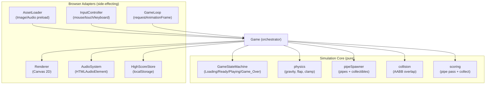

# Design Document

## Overview

Flappy Kiro is a single-page, browser-based endless scroller. The player taps, clicks, or presses Spacebar to make a ghost character ("Ghosty") flap upward against constant gravity, navigating through an endless stream of pipe gaps while collecting "chiikawa" point items. The game runs entirely in a modern web browser with no backend and no build step.

### Technology Choice

The design uses **plain HTML, CSS, and JavaScript (ES modules) with the HTML5 Canvas 2D API**. This is justified by the requirements:

- **Canvas 2D rendering** gives per-pixel control over sprite drawing and lets us disable image smoothing (`imageSmoothingEnabled = false`) to keep pixel-art edges sharp, satisfying Requirement 9.5. DOM/CSS-based sprites cannot reliably guarantee nearest-neighbor scaling across browsers.
- **`requestAnimationFrame` (rAF)** is the standard browser frame-sync primitive and directly supports the delta-time game loop and tab-visibility pause behavior required by Requirement 10.
- **No build step**: Using native ES modules (`<script type="module">`) means the game can be opened directly (via a static file server or a modern browser) without a bundler, transpiler, or package manager. This matches the requirement that the game "run entirely in a modern web browser using existing workspace assets."
- **`localStorage`** provides synchronous, origin-scoped persistence for the high score (Requirement 8.3, 8.4) without any server.
- **`Web Audio` via `HTMLAudioElement`** (the `<audio>`/`Audio()` interface) plays the `.wav` sound effects (Requirements 3.4, 7.4) with graceful failure (Requirements 3.5).

A thin separation is maintained between **pure logic** (physics, spawning, collision, scoring, state transitions) and **side-effecting adapters** (canvas rendering, audio, storage, input, rAF). The pure logic is deterministic given its inputs, which makes it directly testable with property-based tests and keeps rendering/audio concerns out of the simulation.

### Scope

The design covers the full lifecycle described in the requirements: asset loading, the Ready/Playing/Game_Over state machine, flap input and gravity physics, pipe generation and scrolling, pipe-pass and collectible scoring, collision detection, game-over handling, the game-over screen with high-score persistence and restart, retro visual presentation, and a delta-time game loop.

## Architecture

### High-Level Structure

The application is organized into a pure simulation core wrapped by browser-facing adapters. A top-level `Game` orchestrator owns the current state, wires adapters to the core, and drives the loop.



### Design Principles

- **Pure core, impure shell**: Simulation functions take the current `World` (game data) plus inputs (delta time, flap events, RNG) and return a new/updated `World`. They perform no I/O. Rendering, audio, storage, and input live in adapters.
- **Deterministic physics via injected RNG**: Pipe gap size and vertical placement use a seedable random source so that spawning behavior is reproducible and testable (Requirement 4.4, 4.5).
- **Delta-time normalization**: All movement is scaled by elapsed seconds, with a clamp for long frames (Requirement 10.2, 10.3).
- **Normalized spatial units**: Pipe speed, gap size, gap margins, and spawn spacing are specified in the requirements as percentages of Playfield width/height. The core stores these as fractions and the orchestrator resolves them against the current Playfield dimensions, which keeps the simulation resolution-independent.

### Runtime Flow

1. **Boot**: The page loads; `AssetLoader` begins preloading sprites and sounds with a 5-second deadline.
2. **Loading → Ready**: On success the state becomes Ready and the Ghost is placed at the start position with Score 0. On failure (timeout or load error) the state stays Loading and an error message is shown (Requirement 1.1, 1.2).
3. **Ready → Playing**: A flap input starts the game, applying exactly one flap impulse (Requirement 2).
4. **Playing**: Each rAF tick computes delta time, applies gravity/flap, moves and spawns pipes and collectibles, checks collisions, updates score, and renders.
5. **Playing → Game_Over**: A pipe or ground collision ends the game; the game-over sound plays once, motion stops, and the high score is updated (Requirement 7, 8.4).
6. **Game_Over → Ready**: After a 500 ms lockout, a flap input resets the world (Requirement 8.5–8.8).

## Components and Interfaces

All interfaces are described in TypeScript-style notation for precision; the implementation is plain JavaScript (JSDoc types optional).

### Game (Orchestrator)

Owns the `World`, holds references to adapters, and advances the simulation each frame.

```ts
interface Game {
  // Called once after construction; kicks off asset loading.
  start(): void;
  // Advances the simulation by dt seconds and renders. Called by GameLoop.
  tick(dtSeconds: number): void;
  // Routes a flap input into the core based on current state.
  handleFlap(now: number): void;
  // Handles tab visibility changes (pause/resume).
  setVisible(visible: boolean): void;
}
```

### GameStateMachine (core)

Encapsulates valid transitions among `Loading`, `Ready`, `Playing`, `Game_Over`. Rejects invalid transitions so the orchestrator cannot drive the world into an undefined mode.

```ts
type GameState = 'Loading' | 'Ready' | 'Playing' | 'Game_Over';

interface StateMachine {
  readonly state: GameState;
  // Returns true if the transition is allowed from the current state.
  canTransition(to: GameState): boolean;
  // Applies the transition if allowed; returns the resulting state.
  transition(to: GameState): GameState;
}
```

Allowed transitions: `Loading → Ready`, `Ready → Playing`, `Playing → Game_Over`, `Game_Over → Ready`. All others are rejected.

### physics (core)

Pure functions for vertical motion of the Ghost.

```ts
interface Physics {
  // Apply gravity for dt seconds, then clamp to max fall speed (Req 3.1, 3.3).
  applyGravity(ghost: Ghost, dt: number, cfg: PhysicsConfig): Ghost;
  // Replace vertical velocity with the fixed upward flap velocity (Req 3.2).
  applyFlap(ghost: Ghost, cfg: PhysicsConfig): Ghost;
  // Constrain to top boundary, zeroing velocity if clamped (Req 7.3).
  clampToTop(ghost: Ghost): Ghost;
}
```

### pipeSpawner (core)

Generates and recycles pipe pairs and collectibles.

```ts
interface PipeSpawner {
  // Decide whether to spawn based on spacing from the previous pipe (Req 4.2),
  // producing a new PipePair with randomized gap size/position (Req 4.4, 4.5).
  maybeSpawn(world: World, rng: Rng, cfg: SpawnConfig): World;
  // Move all pipes/collectibles left by speed*dt and remove off-screen ones
  // (Req 4.1, 4.3, 6.1, 6.4).
  advance(world: World, dt: number, cfg: SpawnConfig): World;
}
```

### collision (core)

Axis-aligned bounding-box overlap used for pipe collisions, collectible pickup, and ground contact.

```ts
interface Collision {
  // True iff two axis-aligned rectangles overlap (Req 6.2, 7.1).
  overlaps(a: Rect, b: Rect): boolean;
  // True iff the ghost has reached or passed the ground line (Req 7.2).
  touchesGround(ghost: Ghost, groundY: number): boolean;
}
```

### scoring (core)

```ts
interface Scoring {
  // Award +1 the first time the ghost's center crosses a pipe's center
  // (Req 5.1, 5.2). Marks the pipe as scored so no pair scores twice.
  scorePipePasses(world: World): World;
  // Award +1 per newly collected collectible and remove it (Req 6.2, 6.3).
  collectOverlapping(world: World): World;
}
```

**Scoring and collision ordering (Req 5.3).** Within a single Playing tick the orchestrator runs collision detection before `scorePipePasses`. When the Ghost overlaps a pipe, the state transitions to Game_Over, which halts the tick before any pipe point is awarded. Because a point is only granted when the Ghost's center *crosses* a pair's center (a position the Ghost cannot reach without first clearing the pipe rectangles), a collision that occurs before the crossing leaves `scored` false and no point is ever awarded for that pair — satisfying Requirement 5.3.

### AssetLoader (adapter)

```ts
interface LoadedAssets {
  ghost: HTMLImageElement | null;        // assets/ghosty.png
  collectible: HTMLImageElement | null;  // img/chiikawa_point.png
  jumpSound: HTMLAudioElement | null;    // assets/jump.wav
  gameOverSound: HTMLAudioElement | null;// assets/game_over.wav
}

interface AssetLoader {
  // Resolves with assets when all load within deadlineMs; rejects on timeout
  // or error (Req 1.1, 1.2). Individual sprite failure is surfaced per-asset
  // so rendering can fall back (Req 9.2).
  load(deadlineMs: number): Promise<LoadedAssets>;
}
```

### Renderer (adapter)

Draws the world onto the canvas with image smoothing disabled (Requirement 9.5). Falls back to a solid-color placeholder if the ghost sprite is missing (Requirement 9.2). Scrolls the background while Playing and holds it still otherwise (Requirement 9.3, 9.4). Renders the score in a pixel-style font at least 16 px tall (Requirement 9.6).

```ts
interface Renderer {
  resize(width: number, height: number): void;
  render(world: World, assets: LoadedAssets): void;
}
```

### AudioSystem (adapter)

```ts
interface AudioSystem {
  // Plays jump.wav; silently no-ops if unavailable (Req 3.4, 3.5).
  playJump(): void;
  // Plays game_over.wav exactly once per game-over (Req 7.4).
  playGameOver(): void;
}
```

### HighScoreStore (adapter)

```ts
interface HighScoreStore {
  get(): number;          // Reads high score from localStorage (Req 8.3).
  set(score: number): void; // Persists a new high score (Req 8.4).
}
```

### InputController (adapter)

Listens for mouse clicks, touch taps, and Spacebar key presses, normalizing each into a single `flap` event with a timestamp (Requirement 3.7). Prevents default scrolling on Spacebar/touch.

### GameLoop (adapter)

Wraps `requestAnimationFrame`, computes delta time between frames, clamps it to 100 ms (Requirement 10.3), and pauses when the tab is hidden via the Page Visibility API (Requirement 10.4).

## Data Models

Spatial fields on moving entities are stored in absolute pixels resolved against the current Playfield size. Configuration values that the requirements express as percentages are stored as fractions in config and multiplied by Playfield dimensions at spawn/resolve time.

### Rect

```ts
interface Rect {
  x: number;      // left, px
  y: number;      // top, px
  width: number;  // px
  height: number; // px
}
```

### Ghost

```ts
interface Ghost {
  x: number;        // px (fixed horizontal position)
  y: number;        // px (vertical, top-left of bounding box)
  width: number;    // px
  height: number;   // px
  velocityY: number;// px/s (positive = downward)
}
```

### PipePair

```ts
interface PipePair {
  x: number;        // px, left edge of the pair
  width: number;    // px
  gapY: number;     // px, top of the gap
  gapHeight: number;// px, vertical size of the gap
  scored: boolean;  // true once this pair has awarded its point (Req 5.2)
}
```

The top pipe occupies `y ∈ [0, gapY)`; the bottom pipe occupies `y ∈ [gapY + gapHeight, groundY)`. The horizontal center is `x + width / 2`.

### Collectible

```ts
interface Collectible {
  x: number;       // px, left edge
  y: number;       // px, top edge
  width: number;   // px
  height: number;  // px
  collected: boolean; // true once picked up (Req 6.2, 6.3)
}
```

### World

The complete mutable simulation state.

```ts
interface World {
  state: GameState;
  playfield: { width: number; height: number; groundY: number };
  ghost: Ghost;
  pipes: PipePair[];
  collectibles: Collectible[];
  score: number;              // non-negative integer
  highScore: number;          // loaded from storage
  backgroundOffset: number;   // px, for scrolling background (Req 9.3)
  gameOverAt: number | null;  // timestamp of game-over, for restart lockout (Req 8.5, 8.6)
  gameOverSoundPlayed: boolean; // ensures the sound plays once (Req 7.4)
}
```

### PhysicsConfig

```ts
interface PhysicsConfig {
  gravity: number;       // px/s^2 (downward)
  flapVelocity: number;  // px/s (upward, stored as negative)
  maxFallSpeed: number;  // px/s (downward cap, Req 3.3)
}
```

### SpawnConfig

Percentage-based requirement values stored as fractions of Playfield dimensions and resolved against the current Playfield.

```ts
interface SpawnConfig {
  scrollSpeedFrac: number;   // fraction of width/second, in [0.30, 0.50] (Req 4.1)
  spacingFracMin: number;    // 0.40 of width (Req 4.2)
  spacingFracMax: number;    // 0.60 of width (Req 4.2)
  gapFracMin: number;        // 0.20 of height (Req 4.4)
  gapFracMax: number;        // 0.35 of height (Req 4.4)
  verticalMarginFrac: number;// 0.10 of height, top and ground (Req 4.5)
}
```

### Rng

An injectable random source (so spawning is deterministic in tests).

```ts
interface Rng {
  // Returns a float in [0, 1).
  next(): number;
}
```

### GameState

```ts
type GameState = 'Loading' | 'Ready' | 'Playing' | 'Game_Over';
```

### Persistence

The high score is stored in `localStorage` under a single key (e.g. `flappy-kiro.highScore`) as a stringified non-negative integer. Reads tolerate a missing or malformed value by defaulting to 0.

## Correctness Properties

*A property is a characteristic or behavior that should hold true across all valid executions of a system — essentially, a formal statement about what the system should do. Properties serve as the bridge between human-readable specifications and machine-verifiable correctness guarantees.*

Generative, property-based testing applies well to Flappy Kiro's simulation core because physics, spawning, collision, scoring, and state transitions are pure functions with clear input/output behavior over a large input space (arbitrary playfield sizes, velocities, delta times, entity positions, and RNG streams). Asset loading, audio playback, canvas rendering, and storage are side-effecting and are covered by example/integration tests instead (see Testing Strategy).

The following statements were derived from the prework analysis and then consolidated to remove redundancy. Closely related acceptance criteria were combined where one subsumed another, including pipe scoring, collectible pickup, restart lockout, reset invariants, spawn validity, and non-Playing motion.

### Property 1: Ready start position scales with the Playfield

*For any* Playfield width and height, when the Game is in the Ready state the Ghost's horizontal position equals 30% of the Playfield width and its vertical position equals 50% of the Playfield height.

**Validates: Requirements 1.3**

### Property 2: Motion only advances while Playing

*For any* World whose state is not Playing (Loading, Ready, or Game_Over) and *for any* delta time, advancing the simulation leaves every Ghost, Pipe_Pair, and Collectible position and the Ghost velocity unchanged.

**Validates: Requirements 1.6, 7.5**

### Property 3: Gravity accumulates each update

*For any* Ghost whose resulting velocity stays below the maximum fall speed and *for any* delta time, applying gravity increases the Ghost's downward velocity by exactly gravity × delta time.

**Validates: Requirements 3.1**

### Property 4: Flap sets a fixed upward velocity

*For any* Ghost and *for any* prior vertical velocity, applying a flap replaces the Ghost's vertical velocity with the fixed upward flap velocity.

**Validates: Requirements 2.3, 3.2**

### Property 5: Downward velocity is capped

*For any* Ghost and *for any* delta time, after applying gravity the Ghost's downward velocity never exceeds the maximum fall speed.

**Validates: Requirements 3.3**

### Property 6: Flap is ignored outside active states

*For any* Ghost, handling a flap input while the Game is in the Loading state leaves the Ghost's vertical velocity unchanged.

**Validates: Requirements 3.6**

### Property 7: Pipes and collectibles scroll left at the configured speed

*For any* set of Pipe_Pairs and Collectibles and *for any* delta time while Playing, advancing the simulation decreases each entity's x coordinate by exactly scroll speed × delta time, using the same scroll speed for pipes and collectibles, where the scroll speed lies between 30% and 50% of the Playfield width per second.

**Validates: Requirements 4.1, 6.1**

### Property 8: Spawn spacing stays within bounds

*For any* RNG stream, a newly spawned Pipe_Pair is positioned so that the horizontal distance between its left edge and the previous Pipe_Pair's left edge is between 40% and 60% of the Playfield width.

**Validates: Requirements 4.2**

### Property 9: Spawned gaps are valid

*For any* RNG stream, a newly spawned Pipe_Pair has a gap height between 20% and 35% of the Playfield height, with the gap positioned so its top is at least 10% of the Playfield height below the top boundary and its bottom is at least 10% of the Playfield height above the Ground.

**Validates: Requirements 4.4, 4.5**

### Property 10: Off-screen entities are removed

*For any* set of Pipe_Pairs and Collectibles and *for any* delta time, after advancing the simulation no Pipe_Pair or Collectible whose right edge has moved completely past the left boundary of the Playfield remains in the World.

**Validates: Requirements 4.3, 6.4**

### Property 11: Each pipe scores at most once

*For any* Pipe_Pair and Ghost, the first time the Ghost's horizontal center crosses the Pipe_Pair's horizontal center while Playing the Score increases by exactly 1 and the pair is marked scored; applying the scoring step any number of additional times awards no further points for that pair.

**Validates: Requirements 5.1, 5.2**

### Property 12: Collisions suppress the pipe point

*For any* Pipe_Pair and *for any* tick in which the Ghost overlaps that pair while its horizontal center has not yet crossed the pair's horizontal center, advancing the tick leaves that pair's `scored` flag false and does not increase the Score for that pair.

**Validates: Requirements 5.3**

### Property 13: Score is always a non-negative integer

*For any* sequence of scoring operations (pipe passes and collectible pickups), the Score remains a non-negative integer.

**Validates: Requirements 5.4**

### Property 14: Collecting awards exactly one point and is final

*For any* Collectible that overlaps the Ghost's bounding box, the collection step marks it collected and increases the Score by exactly 1; applying the collection step again for the same Collectible awards no further points.

**Validates: Requirements 6.2, 6.3**

### Property 15: Pipe overlap is detected as collision

*For any* Ghost bounding box that overlaps the top or bottom pipe rectangle of any Pipe_Pair, the overlap test returns true.

**Validates: Requirements 7.1**

### Property 16: Ground contact is detected

*For any* Ghost and Ground line, the ground-contact test returns true if and only if the Ghost's bottom edge is at or below the Ground line.

**Validates: Requirements 7.2**

### Property 17: Top boundary clamps position and zeros velocity

*For any* Ghost whose vertical position is above the top boundary, clamping to the top sets the Ghost's vertical position to the top boundary and its vertical velocity to zero.

**Validates: Requirements 7.3**

### Property 18: Game-over sound triggers exactly once

*For any* number of simulation ticks of one or more after the Game enters Game_Over, the game-over sound is triggered exactly once.

**Validates: Requirements 7.4**

### Property 19: Stored high score is the running maximum

*For any* final Score and *for any* previously stored high score, after the Game enters Game_Over the stored high score equals the maximum of the final Score and the previously stored high score.

**Validates: Requirements 8.4**

### Property 20: Restart is gated by the 500 ms lockout

*For any* elapsed time since the Game entered Game_Over, a flap input resets the Game to Ready if and only if the elapsed time is at least 500 milliseconds; otherwise the Game remains in Game_Over.

**Validates: Requirements 8.5, 8.6**

### Property 21: Reset clears the World

*For any* World, resetting the Game to the Ready state removes all Pipe_Pairs and Collectibles and sets the Score to 0.

**Validates: Requirements 8.7, 8.8**

### Property 22: Movement is delta-time invariant

*For any* fixed time interval T and *for any* partition of T into consecutive frames (each delta time at most the 100 ms clamp), the total horizontal displacement of a scrolling entity equals scroll speed × T, independent of how T is partitioned.

**Validates: Requirements 10.2**

### Property 23: Long frames are clamped

*For any* raw delta time, the delta time used for a physics update equals the smaller of the raw delta time and 100 milliseconds.

**Validates: Requirements 10.3**

## Error Handling

- **Asset load failure or timeout (Req 1.2)**: `AssetLoader.load(deadlineMs)` races asset loading against a 5-second timeout. On timeout or any load error it rejects; the orchestrator keeps the state at Loading and the Renderer draws an error message. The Game does not transition to Ready.
- **Missing ghost sprite (Req 9.2)**: If the ghost image is absent from `LoadedAssets`, the Renderer draws a solid-color placeholder rectangle at the Ghost's exact dimensions plus a visible "sprite missing" indication, while gameplay proceeds normally.
- **Audio unavailable (Req 3.5)**: `AudioSystem.playJump` and `playGameOver` wrap playback in a try/catch (and tolerate rejected play promises). Any failure is swallowed so the game loop is never interrupted.
- **Malformed or missing high score (Req 8.3)**: `HighScoreStore.get` parses the stored value and returns 0 when the key is missing or the value is not a valid non-negative integer. `set` is wrapped so a storage quota/availability error does not crash the game (the session simply runs without persistence).
- **Stalled frames (Req 10.3)**: The GameLoop clamps any delta time above 100 ms before it reaches the physics update, preventing position jumps.
- **Tab hidden (Req 10.4)**: On a visibility change to hidden the loop stops advancing physics; on resume it restarts timing from the current timestamp so no accumulated elapsed time is applied.
- **Invalid state transitions**: The GameStateMachine rejects transitions outside the allowed set, protecting the World from undefined modes.

## Testing Strategy

The simulation core and the browser adapters are tested with complementary approaches.

### Property-Based Tests (simulation core)

- **Library**: [fast-check](https://github.com/dubzzz/fast-check) with the test runner already suited to a no-build browser/Node project (Vitest or Jest). fast-check is the standard property-based testing library for JavaScript/TypeScript; it is not implemented from scratch.
- **Coverage**: One property-based test per correctness property (Properties 1–23).
- **Iterations**: Each property test runs a minimum of 100 generated cases (`{ numRuns: 100 }` or higher).
- **Generators**: Custom arbitraries produce random Playfield sizes, Ghost states (position/velocity), Pipe_Pairs, Collectibles, delta times (including values above and below the 100 ms clamp), elapsed-time values around the 500 ms restart threshold, and seeded RNG streams for spawning. A deterministic injected `Rng` makes spawn properties reproducible.
- **Tagging**: Each property test is tagged with a comment referencing its design property, in the format:
  `// Feature: flappy-kiro, Property {number}: {property_text}`

### Unit Tests (examples and edge cases)

Example-based unit tests cover the non-property criteria identified in prework:
- Ready sets Score to 0 and shows the start prompt (Req 1.4, 1.5).
- Ready + flap transitions to Playing and applies exactly one impulse (Req 2.1, 2.3); pipes begin scrolling on the next tick (Req 2.2).
- Input normalization: mouse click, touch tap, and Spacebar each produce a flap event (Req 3.7).
- Game_Over shows final score and restart prompt (Req 8.1, 8.2).
- Edge cases around thresholds (delta time exactly 100 ms, elapsed exactly 500 ms, gap at its min/max margins) — most are also exercised by the property generators.

### Mock-Based Tests (side effects)

- Flap triggers `AudioSystem.playJump`; audio failure does not interrupt the tick (Req 3.4, 3.5).
- Game-over triggers `playGameOver` (count verified by Property 18's flag logic as well).
- `HighScoreStore` reads/writes `localStorage`, including malformed/missing values (Req 8.3, 8.4).

### Integration and Smoke Tests (adapters and environment)

- `AssetLoader` success and failure paths drive Loading → Ready vs. staying in Loading (Req 1.1, 1.2), using mocked image/audio loading.
- Score display updates on the next frame after a score change (Req 5.5).
- High score is displayed on the Game_Over screen from storage (Req 8.3).
- Renderer configuration: image smoothing disabled (Req 9.5) and score font height ≥ 16 px (Req 9.6) are verified as smoke checks on the initialized canvas context.
- Renderer draws the ghost (Req 9.1) and collectible (Req 6.5) sprites, and the placeholder when the ghost sprite is missing (Req 9.2).
- Background scrolls while Playing and holds while Ready/Game_Over (Req 9.3, 9.4).
- Frame-rate targeting (Req 10.1) and tab-visibility pause/resume (Req 10.4) are verified through loop-level tests and manual performance observation across refresh rates.
